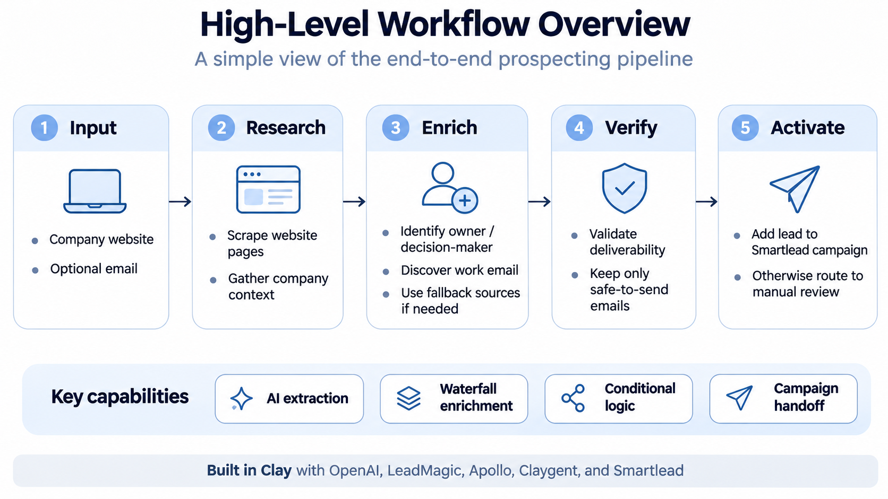
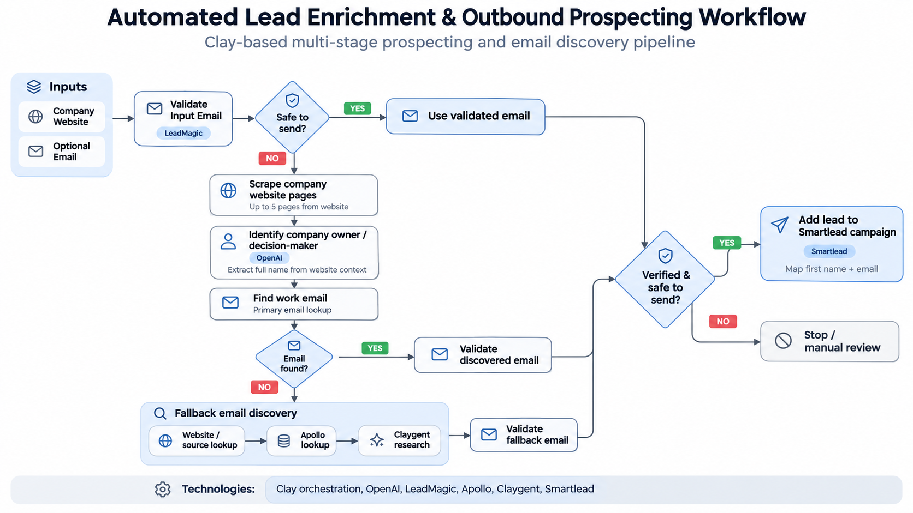
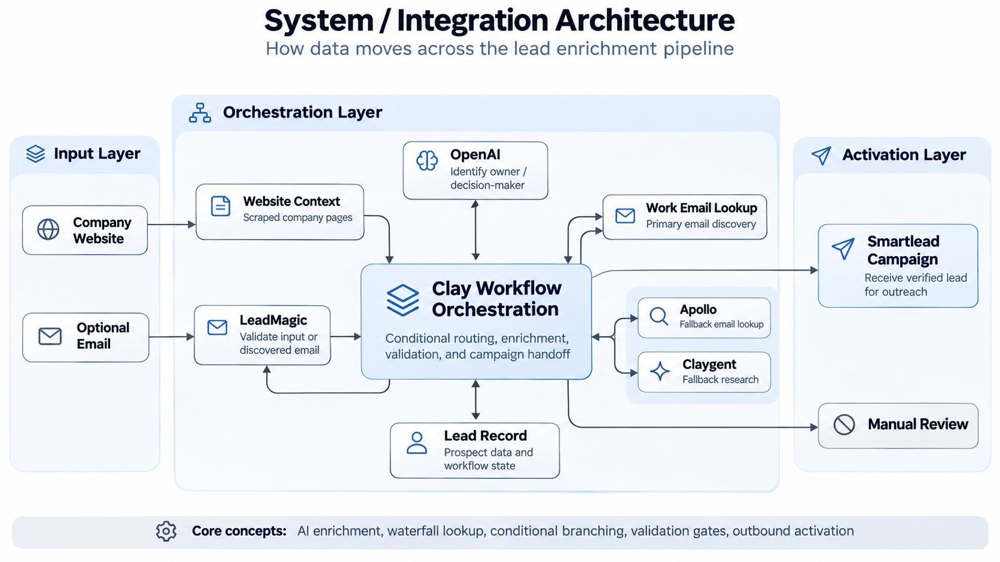

# Automated Lead Enrichment & Outreach Pipeline

**A Clay-based GTM automation workflow for decision-maker identification, email enrichment, verification, and outbound campaign management.**

**Tech Stack:** Clay · OpenAI · LeadMagic · Apollo · Claygent · Smartlead

[View Clay Workflow Template](https://app.clay.com/shared-workbook/share_0to85wlxVkbDPseXaKs)

## 1. Project Overview

This project automates parts of the B2B outbound prospecting process, from company research to preparing verified contacts for outreach.

The workflow accepts a **company website and an optional email address**. It checks whether the supplied email is valid. If a suitable email is unavailable, it researches the company's website, identifies its owner, and searches for a work email using multiple enrichment sources.

The workflow uses **waterfall-style enrichment and conditional routing** to handle failed lookups. Emails are validated before they are passed to the Smartlead campaign integration.

## 2. Problem Statement

Building an outbound prospect list involves several repetitive tasks:

- Visiting company websites to identify founders or decision-makers.
- Finding their professional email addresses.
- Searching multiple data providers when contact information is missing.
- Validating email addresses to reduce the risk of sending to invalid contacts.
- Preparing and importing contact records into outbound campaigns.

These tasks often involve switching between research tools, enrichment providers, and sales engagement platforms.

**The objective:** Build one workflow that handles company research, contact enrichment, email verification, and campaign handoff with less manual work.

## 3. Solution

I built a multi-stage enrichment pipeline in Clay that combines AI-based research with rule-based workflow automation.

The pipeline follows four main principles:

1. **Validate existing data first.** Check the supplied email before searching for a replacement.
2. **Use AI for unstructured research.** Extract company-owner information from website content using an LLM.
3. **Use fallback enrichment.** Search additional sources when the primary email lookup fails.
4. **Verify before activation.** Route only emails meeting the configured validation conditions to the outbound campaign action.

Clay handles workflow orchestration, data mapping, and conditional execution across the integrated services.

## 4. Workflow Architecture

### Step 1 — Input & Initial Email Validation

**Input:** Company website URL and optional email address.

The workflow starts by passing the supplied email to **LeadMagic** for email validation.

The validation step uses the `Only Safe To Send Emails` setting.

- If the email passes the configured check, it can proceed to the campaign handoff branch.
- If the email is missing or unsuitable, the workflow continues to contact discovery.

This avoids unnecessary enrichment when a usable email is already available.

### Step 2 — Company Research & Decision-Maker Identification

When a suitable email is unavailable, the workflow uses information gathered from the company website.

Up to five website-page outputs are supplied to an **OpenAI** enrichment step.

The LLM is instructed to:

- Analyze the company information from the supplied pages.
- Identify the company owner.
- Return the person's full name.
- Leave the output blank if the full name cannot be determined.

This stage uses **LLM-based information extraction** to convert unstructured website content into a contact attribute that can be used for further enrichment.

### Step 3 — Primary Work Email Discovery

The identified person's information is used in a **Work Email** lookup.

This step attempts to find a professional email associated with the contact.

The result is checked through the workflow's conditional logic and relevant validation steps.

If a suitable email is found, the contact can proceed toward campaign enrollment. Otherwise, the workflow continues to additional discovery methods.

### Step 4 — Fallback Email Enrichment

When the initial lookup does not produce a suitable email, the workflow uses additional sources.

The fallback sequence includes:

| Enrichment method | Purpose |
|---|---|
| Website-based email discovery | Search company website content for additional contact information |
| Scraped email verification | Check emails discovered through website research |
| Apollo | Attempt another contact-data lookup |
| Claygent | Use AI-powered research as a later fallback |

The workflow also includes validation steps for emails returned by the additional methods.

This approach is called **waterfall-style enrichment**: attempting multiple sources in a defined order rather than relying on a single provider.

### Step 5 — Conditional Routing & Email Verification

The pipeline uses conditional branches to determine what happens after each lookup.

The routing logic follows three rules:

- **Valid email found:** The record can proceed to the outbound campaign action.
- **No suitable email found:** Continue to the next available discovery method.
- **No verified email after the available methods:** Do not pass an unverified address to the campaign.

Each email-discovery stage has its own output and conditions.

This separates **data discovery** from **data verification** and keeps campaign handoff dependent on the enrichment result.

### Step 6 — Smartlead Campaign Handoff

The final action is configured using Smartlead's **Add Lead to Campaign** integration in Clay.

A separate AI step extracts or prepares the contact's first name for the campaign record.

The action supports fields such as:

- Email address
- First name
- Last name
- Company information
- Additional contact attributes

The current configuration includes first-name mapping, with additional fields available for mapping.

**Integration status:** The Smartlead action has been configured, but the Smartlead account connection is still pending. Successful end-to-end campaign enrollment has not yet been verified.

## 5. System Architecture & Integrations

Clay acts as the central **workflow orchestration layer**, connecting company research, enrichment providers, verification services, and campaign actions.

| Technology | Responsibility |
|---|---|
| **Clay** | Workflow orchestration, conditional execution, column mapping, and enrichment management |
| **OpenAI** | LLM-based company-owner identification and name extraction |
| **LeadMagic** | Email validation and deliverability checks |
| **Work Email** | Primary professional email discovery |
| **Apollo** | Additional contact-data enrichment |
| **Claygent** | AI-powered fallback research |
| **Smartlead** | Outbound campaign enrollment and sales engagement |

The architecture separates three types of work:

**Data enrichment:** Finding missing contact information using external sources.

**AI research:** Interpreting unstructured company content to identify relevant people.

**Workflow orchestration:** Using conditions to decide which enrichment or campaign action should execute next.

## 6. Key Technical Design Decisions

### A. Waterfall Enrichment Instead of a Single Provider

A single email-finding service may fail to identify a contact.

The pipeline therefore uses multiple discovery methods, including work-email lookup, website-based research, Apollo, and Claygent.

**Why:** Increase opportunities to find a usable contact without depending on one data source.

### B. Conditional Execution

Not every contact needs to go through every enrichment step.

For example, a contact with an acceptable supplied email can follow a different path from one requiring additional research.

**Why:** Avoid unnecessary enrichment calls and reduce redundant processing. This design can also help control credit usage, although actual savings have not been measured.

### C. AI for Unstructured Data Extraction

Company websites do not follow a common structure. Owner information may appear in About pages, Team sections, or other content.

The workflow uses an LLM to extract the owner's name from the available website context.

**Why:** Handle information that cannot always be extracted using fixed rules or simple field matching.

### D. Email Verification Before Campaign Handoff

Finding an email does not necessarily mean it is safe to use.

The pipeline includes verification steps and conditions before the campaign action.

**Why:** Reduce the risk of passing invalid or unsuitable email addresses into outbound campaigns.

Email validation does not guarantee delivery, inbox placement, or recipient consent.

## 7. Inputs & Outputs

| Type | Field | Description |
|---|---|---|
| Input | Company website | Starting point for company research |
| Input | Email (optional) | Existing contact email to validate |
| Intermediate | Owner's full name | Extracted from company website context |
| Intermediate | Discovered emails | Results from email lookup and fallback sources |
| Intermediate | Validation results | Used to control conditional routing |
| Output | Prepared contact | Contact information for outbound use |
| Action | Smartlead campaign handoff | Configured campaign-enrollment step; connection pending |

## 8. Project Status & Limitations

The Clay workflow includes the research, enrichment, validation, and conditional-routing stages described above.

The following points are important when evaluating the project:

- **Smartlead connection:** The campaign action still requires an active Smartlead integration.
- **Owner identification:** Results depend on the information available on the company website. AI extraction may fail or return incomplete information.
- **Email availability:** Even with multiple providers, some contacts will not have a discoverable and verifiable email.
- **Performance evaluation:** Enrichment coverage, processing time, credit consumption, and email deliverability have not yet been reported as benchmark results.

This project focuses on **contact enrichment and outbound workflow automation**. It does not currently claim to perform ICP fit scoring, intent-based lead qualification, or automated email personalization.

## 9. Workflow Access

The workflow was built in Clay and can be explored using the shared template:

**[Open the Clay Workflow](https://app.clay.com/shared-workbook/share_0to85wlxVkbDPseXaKs)**

This GitHub repository contains the project documentation and architecture diagrams. The executable automation and provider-specific configurations are maintained in Clay.

---

**Project focus:** GTM Engineering · B2B Outbound Prospecting · Contact Enrichment · Waterfall Enrichment · AI-Powered Research · Email Verification · Conditional Workflow Automation · Sales Engagement Integration
